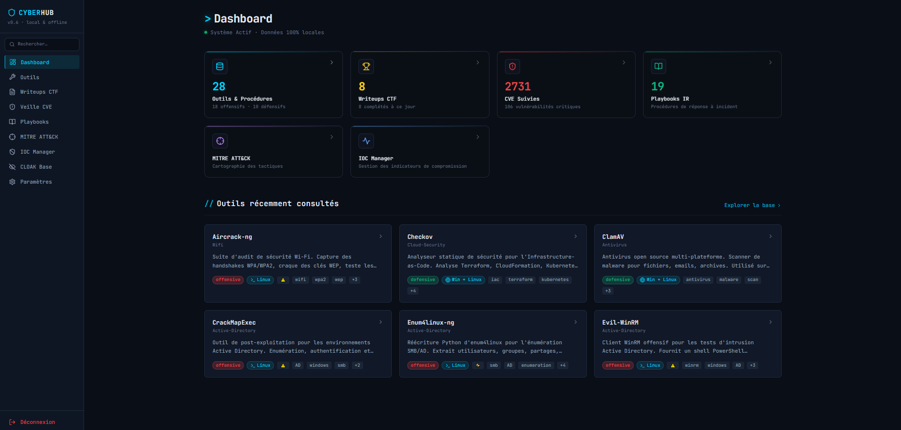
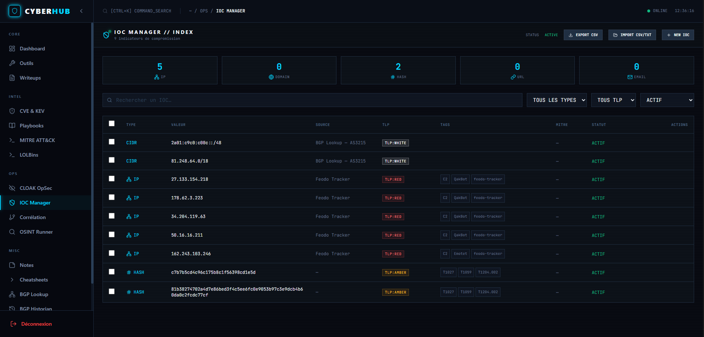
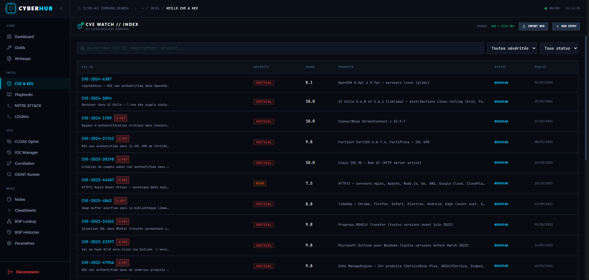
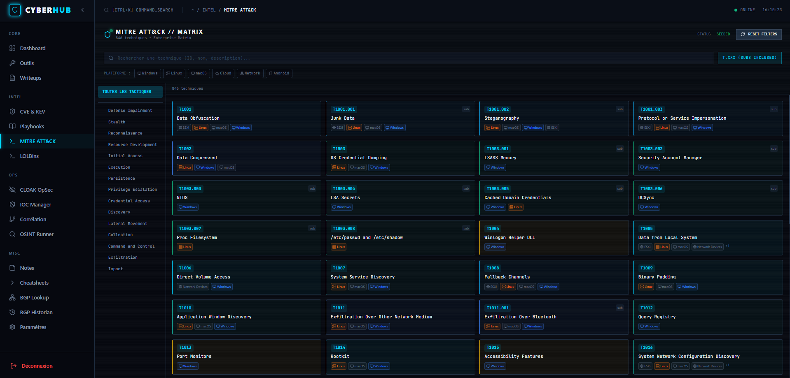

# CYBER-HUB v1.1

> Hub de ressources cybersécurité local ; certains imports et flux demandent Internet.


Application de bureau pour centraliser outils, writeups CTF, veille CVE, playbooks de réponse à incident, gestion d'IOC, analyse BGP/AS, OSINT et investigation. Inclut **[CLOAK OpSec](https://github.com/mickdeben/concealment)** (Mick Deben, Leiden University — GPL v2), les bases [LOLBAS](https://lolbas-project.github.io/) et [GTFOBins](https://gtfobins.github.io/), ainsi que les flux [Feodo Tracker](https://feodotracker.abuse.ch/) et [URLhaus](https://urlhaus.abuse.ch/) (abuse.ch).

---

## Modules

- **Dashboard** — KPIs visuels, graphiques (writeups, CVE par sévérité, top outils, IOCs récents, corrélations)
- **Outils** — 59 fiches techniques (offensif, défensif, OSINT, forensics, cloud, reverse engineering)
- **CTF Writeups** — Gestion par plateforme (TryHackMe, HackTheBox) · 8 writeups inclus
- **Veille CVE** — Base locale + import NVD JSON/API paginé · badge CISA KEV 🔥 · score EPSS (FIRST.org)
- **Playbooks** — 19 procédures de réponse à incident interactives (checklist step-by-step)
- **MITRE ATT&CK** — 823 techniques · 14 tactiques · format STIX 2.0 · 100% offline · **ATT&CK Layers** : création et visualisation de couches d'annotation par technique
- **CLOAK OpSec** — 720 sous-techniques · 13 tactiques · anonymat, dissimulation, OpSec · 100% offline
- **IOC Manager** — IP/domaine/hash/URL/email/CIDR · TLP · sélection groupée · import CSV/TXT en masse
- **Hash Analyzer** — VirusTotal · MalwareBazaar · ThreatFox · URLhaus · 4 sources parallèles · cache SQLite
- **BGP / AS Lookup** — Proxy BGPView · cache SQLite TTL 1h · fallback RIPE Stat · export IOC CIDR
- **BGP Historian** — Snapshots AS périodiques · diff visuel · alertes automatiques sur changements de routage
- **OSINT Runner** — Exécution locale WhatsMyName · extraction IOC · import direct
- **Notes** — Éditeur opérationnel · liens IOC/MITRE/CVE · recherche fulltext · import/export JSON/MD/TXT/HTML
- **Investigations** — Timeline d'investigation avec événements horodatés
- **Corrélation IOC** — Moteur 9 goroutines · matching CVE, playbooks, MITRE, LOLBins, BGP, threat feeds
- **LOLBins & GTFOBins** — 232 binaires Windows (LOLBAS) + 15+ Linux · filtres MITRE + catégorie · copie en un clic
- **Cheatsheets** — 35+ outils · commandes paramétrables · variables dynamiques · copie en un clic
- **Encoder / Decoder** — Base64 ↔ URL ↔ Hex ↔ ROT13 ↔ HTML entities · preview temps réel · 100% offline
- **Reverse Shell Generator** — Payloads pour 16 langages · encodage none/base64/url · listener netcat auto
- **Paramètres** — Backup SQLite · export/import JSON · clés API VirusTotal/NVD · sync CISA KEV + threat feeds

---

## Prérequis

- **Go** ≥ 1.27.2 — [golang.org/dl](https://golang.org/dl/)
- **Node.js** 24 + npm pour le build frontend local — [nodejs.org](https://nodejs.org/)

---

## Installation & Build

```bash
git clone https://github.com/loic31000/CyberHub.git
cd CyberHub
```

**Build Windows en une commande :**

```powershell
# Windows
.\build.ps1
```

> Le build React écrit directement dans `backend/web/`, puis `build.ps1` compile Go avec `CGO_ENABLED=0`.

**Build manuel :**

```bash
# 1. Frontend
cd frontend && npm ci && npm run build && cd ..

# 2. Backend
cd backend
CGO_ENABLED=0 go build -ldflags="-s -w" -o ../cyber-hub.exe .   # Windows
# CGO_ENABLED=0 go build -ldflags="-s -w" -o ../cyber-hub .     # Linux/macOS
```

> `CGO_ENABLED=0` est requis — le driver SQLite (`glebarez/sqlite`) est pur Go, sans dépendance C.

---

## Lancement

```bash
./cyber-hub.exe   # Windows
./cyber-hub       # Linux/macOS
```

L'application démarre sur **http://localhost:7743** et ouvre le navigateur automatiquement.

**Premier démarrage :** créer un compte local via le backend. Les données de référence se chargent au démarrage; MITRE ATT&CK peut nécessiter une connexion réseau. CLOAK est embarqué dans l'application.

---

## Développement

Pour utiliser le backend Docker existant et le hot reload Vite, suivre [le guide Windows Docker + Vite](DEVELOPMENT.md). Le frontend de développement est sur `http://localhost:5173`; le build embarqué est sur `http://localhost:7743`.

```bash
# Vérification TypeScript
cd frontend && npx tsc --noEmit

# Formatage Go
cd backend && gofmt -w ./internal/...

# Lancer les tests backend (SQLite in-memory, pas de serveur requis)
cd backend && go test ./internal/api/handlers/...

# Réinitialiser le mot de passe (accès perdu)
cd backend && go run cmd/reset-auth/main.go
```

---

## Aperçu

### Dashboard


### IOC Manager


### CVE Watch + CISA KEV


### MITRE ATT&CK


---

## Crédits & sources open-source

| Source | Usage dans Cyber-Hub | Licence |
|--------|----------------------|---------|
| [CLOAK — Mick Deben, Leiden University](https://github.com/Mickinthemiddle/CLOAK) | Base CLOAK OpSec (720 sous-techniques · 13 tactiques) | GPL v2 |
| [LOLBAS Project](https://lolbas-project.github.io/) | LOLBins Windows (232 binaires) | CC BY-SA |
| [GTFOBins](https://gtfobins.github.io/) | LOLBins Linux (15+ binaires) | CC BY-SA |
| [MITRE ATT&CK](https://attack.mitre.org/) | Framework ATT&CK Enterprise (STIX 2.0 officiel) | Apache 2.0 |
| [CISA KEV](https://www.cisa.gov/known-exploited-vulnerabilities-catalog) | Known Exploited Vulnerabilities (catalogue officiel) | Domaine public |
| [EPSS — FIRST.org](https://www.first.org/epss/) | Exploit Prediction Scoring System (API v3) | — |
| [Feodo Tracker — abuse.ch](https://feodotracker.abuse.ch/) | IPs C2 Cobalt Strike / Emotet / QakBot | CC0 |
| [URLhaus — abuse.ch](https://urlhaus.abuse.ch/) | URLs malveillantes actives | CC0 |
| [NVD — NIST](https://nvd.nist.gov/) | Base CVE (API v2 paginée) | Domaine public |
| [BGPView](https://bgpview.io/) | API BGP / ASN lookup (proxy local) | — |

---

## Sécurité

Bind sur `127.0.0.1` uniquement — aucun accès réseau externe. JWT HS256 · bcrypt · rate limit login 8 req/min · `X-Frame-Options: DENY` · `X-Content-Type-Options: nosniff` · aucun secret en dur (JWT secret et clés API stockés en DB).

---

## Changelog

→ [CHANGELOG.md](CHANGELOG.md)

---

## Licence & Avertissement

Cyber-Hub est destiné **exclusivement à un usage légal et éthique** : tests sur vos propres systèmes, environnements de lab, CTF, formation. L'utilisation sur des systèmes sans autorisation explicite est illégale.

CLOAK est distribué sous licence GPL v2 — crédit : Mick Deben, Leiden University.

---

*Cyber-Hub v1.1 — mis à jour le 10/05/2026*
