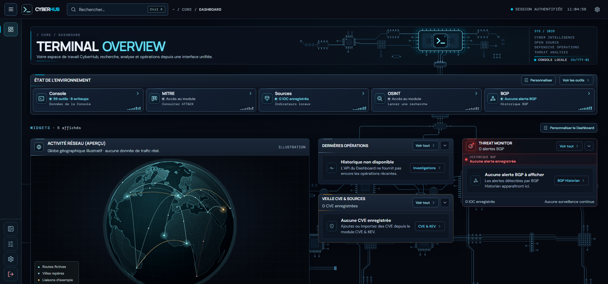

# CyberHub

**Console CyberHub 2026 intégrée sur `main`.** Le numéro v1.1 désigne la dernière version documentée avant cette intégration ; aucun nouveau tag de version n'a encore été créé.

> Hub de ressources cybersécurité local ; certains imports et flux demandent Internet.

[](https://github.com/loic31000/CyberHub/actions/workflows/frontend-ci.yml)


[](LICENSE)


Console web locale pour centraliser outils, writeups CTF, veille CVE, playbooks de réponse à incident, gestion d'IOC, analyse BGP/AS, OSINT et investigation. Inclut **[CLOAK OpSec](https://github.com/Mickinthemiddle/CLOAK)** (Mick Deben, Leiden University - GPL v2), les bases [LOLBAS](https://lolbas-project.github.io/) et [GTFOBins](https://gtfobins.github.io/), ainsi que les flux [Feodo Tracker](https://feodotracker.abuse.ch/) et [URLhaus](https://urlhaus.abuse.ch/) (abuse.ch).

---

## État du projet au 24 octobre 2026

À `main` (`882c1b68`), la Console CyberHub 2026 intègre le Dashboard et le shell initial ([PR #27](https://github.com/loic31000/CyberHub/pull/27)), BGP Lookup et Historian 2.0 ([PR #39](https://github.com/loic31000/CyberHub/pull/39)), CVE & KEV 2026 ([PR #41](https://github.com/loic31000/CyberHub/pull/41)) et Investigations 2026 ([PR #43](https://github.com/loic31000/CyberHub/pull/43)). La [PR #42](https://github.com/loic31000/CyberHub/pull/42) a limité les animations au repos, puis la [PR #44](https://github.com/loic31000/CyberHub/pull/44) a restauré les LED et trajets animés du circuit, avec pause lorsque l'onglet est masqué et respect de `prefers-reduced-motion`. Les performances des animations actives restent à optimiser.

Il s'agit toujours d'une application personnelle locale : backend **Go**, frontend **React**, base **SQLite** locale, données de la Console derrière l'authentification existante. Le globe et le circuit du Dashboard sont illustratifs ; ils ne montrent pas du trafic réel. La réduction des animations coûteuses au repos n'est pas présentée comme définitivement résolue.

| Chantier | État actuel |
| --- | --- |
| Dashboard, BGP Lookup / Historian 2.0, CVE & KEV 2026, Investigations 2026 | Intégrés dans `frontend/` sur `main`. |
| Dashboard et animations | PR #42 et [restauration visuelle #44](https://github.com/loic31000/CyberHub/pull/44) fusionnées ; LED et circuits animés conservés. L'optimisation des animations actives reste un chantier ouvert. |
| Playbooks 2026 | En développement sur une branche dédiée ; les nouveaux écrans ne sont pas intégrés à `main`. Les 19 playbooks historiques restent disponibles. |
| Landing / Showcase 2026 | Prototype autonome sur [`feat/cyberhub-2026-design`](https://github.com/loic31000/CyberHub/tree/feat/cyberhub-2026-design), [PR #25 en brouillon](https://github.com/loic31000/CyberHub/pull/25), distinct de la Console ; aucune intégration réalisée. |

Le projet reste destiné à un usage local et au partage du code source, **sans service SaaS ni déploiement Internet de la Console prévu**. La cible d'architecture demeure un seul frontend React pour la Console et, si elle est intégrée plus tard, la landing. La démo de la Landing utilise exclusivement des données fictives et n'accède ni à l'authentification, ni aux API privées, ni à SQLite.

Documents de suivi : [architecture](docs/cyberhub-2026/architecture.md), [suivi d'intégration des branches](docs/BRANCH-INTEGRATION.md), [feuille de route](docs/cyberhub-2026/implementation-roadmap.md), [plan d'intégration Landing](docs/cyberhub-2026/landing-integration-plan.md), [développement local](DEVELOPMENT.md), [crédits/licences](docs/LICENSING.md).

---

## Modules

- **Dashboard 2026** - Terminal Overview, cartes d'environnement et widgets personnalisables ; statistiques et aperçus reliés aux API existantes, avec états de chargement, vide et erreur. Globe et circuit illustratifs.
- **Outils** - 59 fiches techniques (offensif, défensif, OSINT, forensics, cloud, reverse engineering)
- **CTF Writeups** - Gestion par plateforme (TryHackMe, HackTheBox) · 8 writeups inclus
- **CVE & KEV 2026** - Veille CVE locale + import NVD JSON/API paginé · badge CISA KEV 🔥 · score EPSS (FIRST.org)
- **Playbooks historiques** - 19 procédures de réponse à incident interactives (checklist step-by-step) ; le chantier Playbooks 2026 reste en développement, hors de `main`.
- **MITRE ATT&CK** - catalogue local de tactiques et techniques, Explorer, fiches et préférences d'affichage ; **ATT&CK Layers** : création, visualisation et export de couches d'annotation. Le contenu disponible dépend des données synchronisées localement.
- **CLOAK OpSec** - 720 sous-techniques · 13 tactiques · anonymat, dissimulation, OpSec · 100% offline
- **IOC Manager** - poste de travail 2026 avec inspecteur d'indicateur et Intelligence Map (corrélations locales vers techniques MITRE ATT&CK, CVE et playbooks), ouverture directe de la fiche MITRE correspondante · IP/domaine/hash/URL/email/CIDR · TLP · sélection groupée · import CSV/TXT en masse. Les niveaux de confiance des corrélations sont des indications heuristiques, pas des probabilités de compromission.
- **Hash Analyzer** - VirusTotal · MalwareBazaar · ThreatFox · URLhaus · 4 sources parallèles · cache SQLite
- **BGP / AS Lookup** - API RIPE Stat · résolution DNS via Cloudflare DNS-over-HTTPS · cache SQLite 10 min · export IOC CIDR
- **BGP Historian 2.0** - Snapshots AS sourcés · comparaisons et provenance ; associé au module BGP / AS Lookup
- **OSINT Runner** - Search Workstation : recherche de pseudonyme sur le catalogue WhatsMyName local, périmètre par catégorie, historique et rapports, tri et filtres des profils trouvés, import des résultats en IOC. Le **Signal Globe** est une visualisation symbolique de la recherche : ses ondes et points ne représentent pas des sites ou détections individuels ; seuls les compteurs (sites vérifiés, progression, profils trouvés) sont des données réelles.
- **Notes** - Éditeur opérationnel · liens IOC/MITRE/CVE · recherche fulltext · import/export JSON/MD/TXT/HTML
- **Investigations 2026** - Dossiers d'investigation et timeline d'événements horodatés
- **Corrélation IOC** - Moteur 9 goroutines · matching CVE, playbooks, MITRE, LOLBins, BGP, threat feeds
- **LOLBins & GTFOBins** - 232 binaires Windows (LOLBAS) + 15+ Linux · filtres MITRE + catégorie · copie en un clic
- **Cheatsheets** - 35+ outils · commandes paramétrables · variables dynamiques · copie en un clic
- **Encoder / Decoder** - Base64 ↔ URL ↔ Hex ↔ ROT13 ↔ HTML entities · preview temps réel · 100% offline
- **Reverse Shell Generator** - Payloads pour 16 langages · encodage none/base64/url · listener netcat auto
- **Paramètres** - Backup SQLite · export/import JSON · clés API VirusTotal/NVD · sync CISA KEV + threat feeds

**Navigation 2026** - rail **Essentiel** (Dashboard, jusqu'à cinq favoris dans l'ordre choisi, module courant) ou **Complet** (tous les modules), tiroir « Tous les modules », préférences d'affichage et de densité, recherche globale **Ctrl+K** (Cmd+K sur macOS).

---

## Prérequis

- **Go** ≥ 1.27.2 - [golang.org/dl](https://golang.org/dl/)
- **Node.js** 24 + npm pour le build frontend local - [nodejs.org](https://nodejs.org/)

---

## Installation & Build

```bash
git clone https://github.com/loic31000/CyberHub.git
cd CyberHub
```

**Build Windows en une commande :**

```powershell
# Windows
.\build.ps1
```

> Le build React écrit directement dans `backend/web/`, puis `build.ps1` compile Go avec `CGO_ENABLED=0`.

**Build manuel - Windows (PowerShell) :**

```powershell
# 1. Frontend : écrit le build dans backend/web
cd frontend
npm ci
npm run build
cd ..

# 2. Backend
cd backend
$env:CGO_ENABLED = "0"
go build -ldflags="-s -w" -o ..\cyber-hub.exe .
cd ..
```

**Build manuel - Linux / macOS (Bash) :**

```bash
cd frontend && npm ci && npm run build && cd ..
cd backend && CGO_ENABLED=0 go build -ldflags="-s -w" -o ../cyber-hub . && cd ..
```

> `CGO_ENABLED=0` est utilisé par les builds du dépôt : le driver SQLite (`glebarez/sqlite`) est pur Go, sans dépendance C. Le serveur embarque `backend/web` (`go:embed`) : construire le frontend **avant** de compiler ou tester le backend. Ce dossier est généré et ignoré par Git.

---

## Lancement

```powershell
.\cyber-hub.exe   # Windows (PowerShell)
```

```bash
./cyber-hub       # Linux / macOS
```

L'application démarre sur **http://localhost:7743** et ouvre le navigateur automatiquement.

**Premier démarrage :** créer un compte local via le backend. Les données de référence se chargent au démarrage; MITRE ATT&CK peut nécessiter une connexion réseau. CLOAK est embarqué dans l'application.

---

## Développement

Pour utiliser le backend Docker existant et le hot reload Vite, suivre [le guide Windows Docker + Vite](DEVELOPMENT.md). Le frontend de développement est sur `http://localhost:5173`; le build embarqué est sur `http://localhost:7743`. Exécuter les commandes npm dans `frontend/` après installation des dépendances (`npm ci`). Depuis la racine, `npm run dev` ne correspond pas au serveur du frontend principal.

Le Dashboard 2026 est servi par le frontend principal. Les commandes du laboratoire Landing / Showcase restent documentées sur sa branche distincte.

Vérifications, à lancer depuis le dossier indiqué (commandes identiques sous PowerShell et Bash) :

```bash
# Dans frontend/
npx tsc --noEmit          # vérification TypeScript
npm test                  # tests Vitest
npm run build             # build Vite, écrit dans backend/web

# Dans backend/ (après un build frontend)
go test ./...             # tests Go (SQLite in-memory, pas de serveur requis)
go vet ./...
gofmt -l .                # liste les fichiers Go à formater, sans les modifier
go run ./cmd/reset-auth   # réinitialiser le mot de passe (accès perdu)
```

Pour un build de contrôle qui ne touche pas `backend/web`, la CI utilise un dossier temporaire : `npm run build -- --outDir <dossier-temporaire> --emptyOutDir`.

### Intégration continue

Le workflow [Frontend CI](.github/workflows/frontend-ci.yml) s'exécute sur les pull requests et sur `main` lorsque `frontend/` change : `npm ci`, `npx tsc --noEmit`, `npm test` (Vitest) et build Vite vers un dossier temporaire. Il est **ciblé sur le frontend** : il ne lance pas les tests Go et ne vérifie ni les opérations métier, ni les services externes.

---

## Aperçu

### CyberHub 2026 — Terminal Overview



*Console CyberHub 2026 intégrée au frontend principal, ici sur une base vide. Le globe et les éléments graphiques sont illustratifs.*

---

## Crédits & sources open-source

| Source | Usage dans Cyber-Hub | Licence |
|--------|----------------------|---------|
| [CLOAK - Mick Deben, Leiden University](https://github.com/Mickinthemiddle/CLOAK) | Base CLOAK OpSec (720 sous-techniques · 13 tactiques) | GPL v2 |
| [LOLBAS Project](https://github.com/LOLBAS-Project/LOLBAS/blob/master/NOTICE.md) | Données LOLBins Windows (source intégrée) | **GPL-3.0** : provenance/version et notices à vérifier |
| [GTFOBins](https://github.com/GTFOBins/GTFOBins.github.io) | Données LOLBins Linux (source intégrée) | **GPL-3.0** : provenance/version et notices à vérifier |
| [MITRE ATT&CK](https://attack.mitre.org/resources/terms-of-use/) | Framework ATT&CK Enterprise | **Licence et termes MITRE spécifiques**, avec mention de copyright obligatoire pour les copies |
| [CISA KEV](https://www.cisa.gov/known-exploited-vulnerabilities-catalog) | Known Exploited Vulnerabilities (catalogue officiel) | Domaine public |
| [EPSS - FIRST.org](https://www.first.org/epss/) | Exploit Prediction Scoring System (API) | Conditions du fournisseur à vérifier |
| [Feodo Tracker - abuse.ch](https://feodotracker.abuse.ch/about/) | Flux d'indicateurs | Conditions de service à vérifier (CC0 non confirmé) |
| [URLhaus - abuse.ch](https://urlhaus.abuse.ch/about/) | Flux d'URLs | Conditions de service à vérifier (CC0 non confirmé) |
| [NVD - NIST](https://nvd.nist.gov/) | Base CVE (API v2 paginée) | Domaine public |
| [RIPE Stat](https://stat.ripe.net/) | API BGP / ASN lookup | Conditions du fournisseur à vérifier |
| [Cloudflare DNS-over-HTTPS](https://developers.cloudflare.com/1.1.1.1/encryption/dns-over-https/) | Résolution DNS du module BGP | Conditions du fournisseur à vérifier |
| [WhatsMyName](https://github.com/WebBreacher/WhatsMyName) | Catalogue de sites de l'OSINT Runner (`wmn-data.json`) | Licence de la version embarquée à vérifier |
| [Natural Earth](https://www.naturalearthdata.com/about/terms-of-use/) | Contours du globe illustratif du Dashboard | Domaine public |
| [DM Sans, DM Mono, Manrope](frontend/public/dashboard-2026/fonts/) | Polices de la Console 2026 (textes de licence fournis) | SIL Open Font License 1.1 |

---

## Sécurité

**Écoute locale.** Le binaire écoute par défaut sur `127.0.0.1:7743`. Dans l'image Docker, le serveur écoute sur toutes les interfaces du conteneur (`CYBER_HUB_LISTEN_ALL=1`), mais `compose.yaml` ne publie le port que sur `127.0.0.1` de l'hôte.

**Connexions sortantes.** Certaines fonctions contactent des services externes lorsqu'elles sont utilisées : import NVD, synchronisation CISA KEV et threat feeds (abuse.ch), analyse de hash (VirusTotal, MalwareBazaar, ThreatFox, URLhaus), score EPSS (FIRST.org), BGP (RIPE Stat, Cloudflare DNS-over-HTTPS), téléchargement des données MITRE ATT&CK et des mises à jour CLOAK et WhatsMyName depuis GitHub, et recherches OSINT vers les sites du catalogue WhatsMyName.

**Mesures en place.** JWT HS256 · mots de passe bcrypt · limitation du login à 8 requêtes/min par IP · `X-Frame-Options: DENY` · `X-Content-Type-Options: nosniff` · pas de secret en dur (secret JWT et clés API stockés en base locale).

Ces mesures ne constituent pas un audit de sécurité. L'application est conçue pour un usage local ; l'exposer sur un réseau exigerait une revue distincte.

---

## Limites connues

Les tests automatisés couvrent TypeScript, des tests Vitest ciblés, le build et des tests Go de handlers. Les smoke tests réalisés lors de l'intégration ont validé des parcours ciblés avec le vrai backend authentifié. Ils ne constituent pas une validation exhaustive des créations, éditions et suppressions, des imports, des synchronisations, des scans OSINT réels, de la sécurité de production, de l'accessibilité complète ni de tous les cas responsive.

---

## Changelog

→ [CHANGELOG.md](CHANGELOG.md)

---

## Licence & Avertissement

Cyber-Hub est destiné **exclusivement à un usage légal et éthique** : tests sur vos propres systèmes, environnements de lab, CTF, formation. L'utilisation sur des systèmes sans autorisation explicite est illégale.

**Le code original de CyberHub, pour lequel le titulaire détient les droits, est placé sous licence [MIT](LICENSE)**, avec la mention `Copyright (c) 2026 loic31000`. Conserver la notice de copyright et le texte de licence lors des copies ou redistributions du code concerné.

**Cette licence MIT ne remplace pas les licences ou conditions propres aux contenus tiers.** Des données tierces sont notamment incorporées : CLOAK (GPL v2), LOLBAS et GTFOBins (GPL-3.0). Les conditions de MITRE ATT&CK sont spécifiques. Les obligations de provenance, d'attribution, de licence et de redistribution restent à vérifier selon les fichiers et modes de distribution. Voir l'[inventaire des licences et des points à vérifier](docs/LICENSING.md).

---

*Documentation de statut actualisée le 24/10/2026 sur `main` `882c1b68`. Le correctif du circuit animé (PR #44) est intégré ; la Landing et Playbooks 2026 ne sont pas encore intégrés.*
